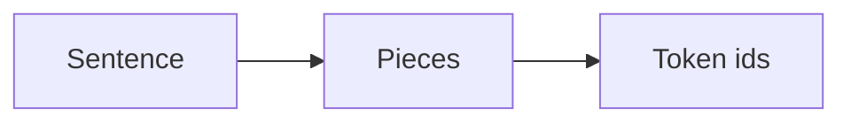

# Tokens

## What this topic is

A language model reads token ids, not raw characters. The same sentence can produce a different count under a different tokenizer.

## Why an Android AI engineer needs it

Context limits and Prompt API quotas are counted in tokens.

## Diagram

## What you will change

- One sentence

## Pass condition

The shown token count equals the splitter used by the lab.

## Sources

- [Machine Learning Glossary](https://developers.google.com/machine-learning/glossary)
- [Prompt API](https://developers.google.com/ml-kit/genai/prompt/android)
