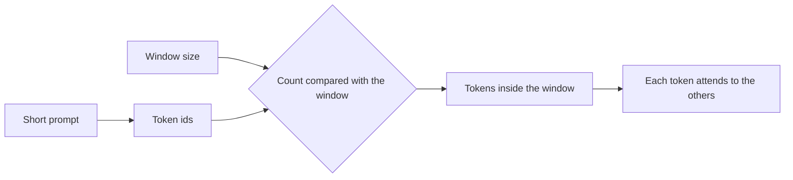

# Transformers, intuition

A transformer language model reads a window of tokens and lets each token look at the others in that window. That look is attention. This lab does not train a transformer and does not ask you to derive the math. It asks you to respect the one limit that decides whether the model can see your prompt at all: the context window, measured in tokens.

Suggested after [Reading a model output](../lab-outputs/README.md).

## Attention, in one picture

Line the tokens up. For each token, attention builds a new representation by mixing information from tokens in the same window. "It" can pick up "the model" from earlier in the sentence because both positions are inside the window and the pattern of the sentence makes that link useful. Positions outside the window are absent. The model cannot attend to them, because they were never presented.

You will see stacks of these layers in a real model, plus the feed-forward pieces between them. For shipping an app, the layer count is the model author’s problem. Your problem is the window.

## The window is a budget

You type a short prompt and a window size in tokens. The lab tokenizes the prompt with the splitter from the tokens topic and compares the count with the window.

- The count fits in the window: every token you wrote is visible on this run.
- The count overflows: some of your tokens are outside the window. Whatever truncation policy you use, those tokens do not participate in attention.

A window of 128 and a prompt of 40 tokens fits. A window of 128 and a pasted document of 900 tokens overflows. The model will still answer. The answer is about the slice that remained, which is a painful bug when the question was at the end and the policy kept the beginning.

Leave room for the answer. If the window holds 1024 tokens and the prompt uses 1000, the model has a small remainder in which to write. Prompt, system instruction, examples, and the generated reply share one budget.

This course stops at that intuition on purpose. Training, fine-tuning, and the internals of multi-head attention are outside the practitioner path. You need to know what the window is so later labs — prompting, RAG, Gemini Nano, LiteRT-LM — have a number you can check.

## Tokens in, window, attention

## What you will change

- A short prompt
- A window size in tokens

## Pass condition

The lab marks the prompt as fitting or overflowing that window.

## Sources

- [Machine Learning Glossary](https://developers.google.com/machine-learning/glossary)
