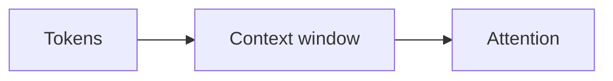

# Transformers, intuition

## What this topic is

Attention lets each token look at the others in the context window. This lab does not train a transformer.

## Why an Android AI engineer needs it

Gemini Nano and LiteRT LM both refuse a prompt that overflows the window.

## Diagram

## What you will change

- A short prompt
- A window size in tokens

## Pass condition

The lab marks the prompt as fitting or overflowing that window.

## Sources

- [Machine Learning Glossary](https://developers.google.com/machine-learning/glossary)
